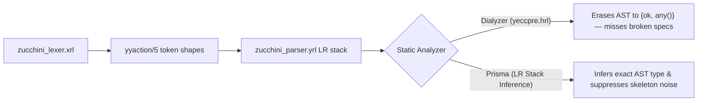
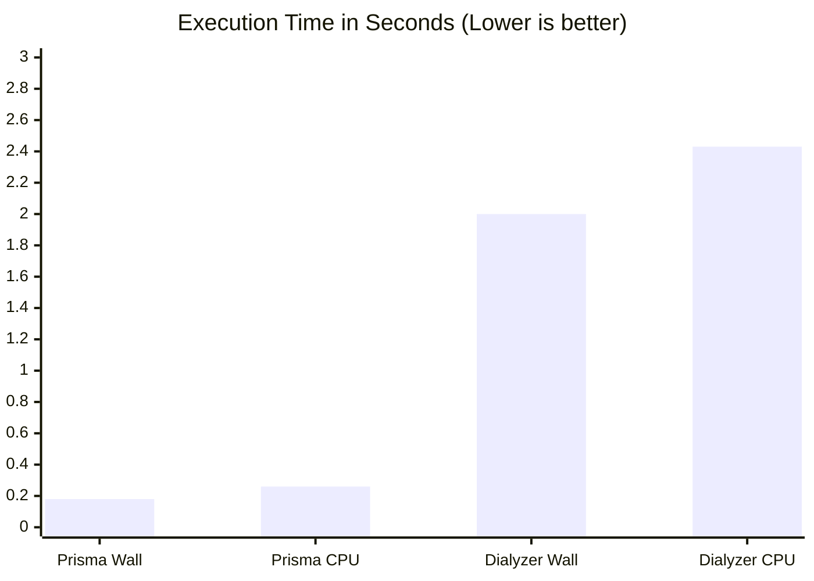
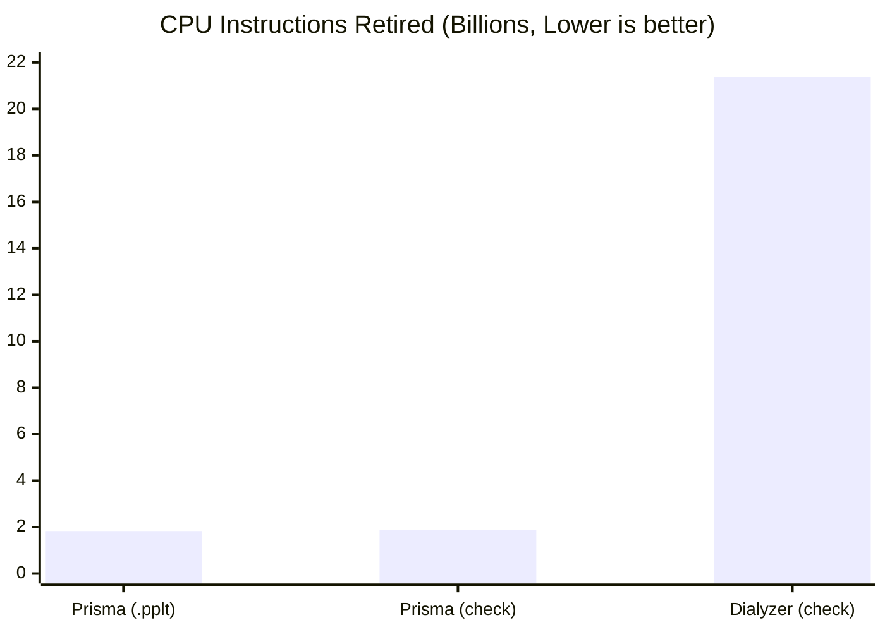
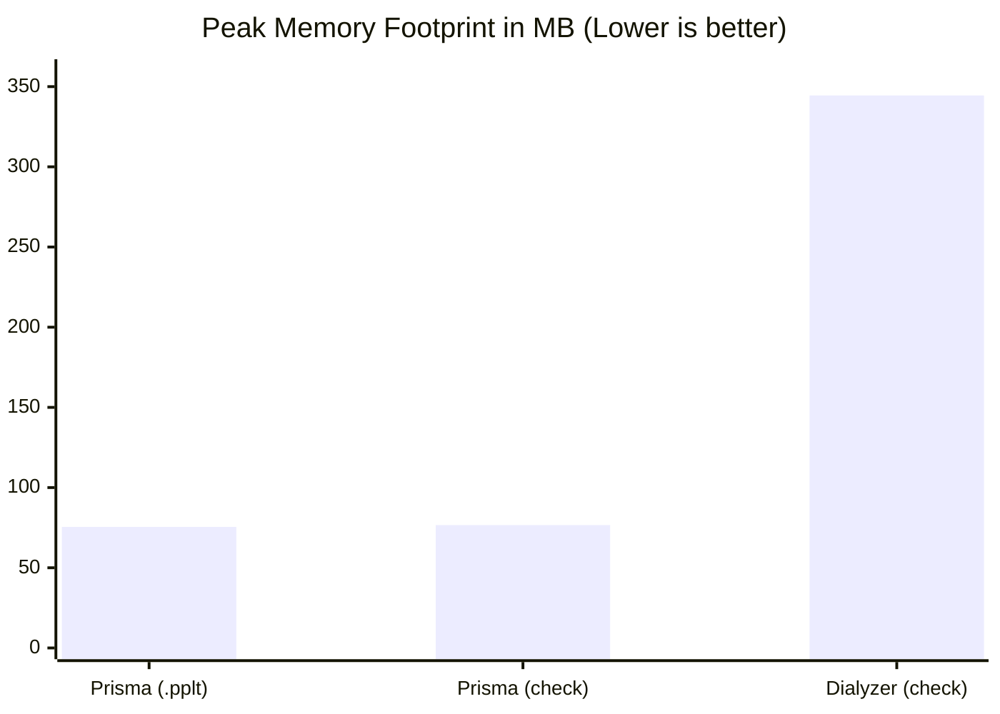

id              : zucchini
date            : 2026-11-06
updated         : 2026-11-06
title           : Case Study & Benchmark: zucchini
subtitle        : Inferring exact AST types across leex and yecc parsers where Dialyzer goes blind
author          : Manuel Rubio
category        : Benchmarks
group           : ephp
tags            : erlang, dialyzer, prisma, zucchini, ephp, leex, yecc, benchmark, static-analysis
project         : zucchini
repo            : https://github.com/bragful/zucchini
modules         : 3
core_modules    : 1
zone_modules    : 2
otp_release     : 29
erts_version    : 17.1.1
prisma_wall_s   : 0.18
prisma_cpu_s    : 0.26
prisma_pplt_kb  : 5
dialyzer_wall_s : 2.00
dialyzer_cpu_s  : 2.43
dialyzer_plt_kb   : 1446
prisma_warnings   : 1
dialyzer_warnings : 0
summary           : Benchmark and case study of zucchini (Erlang INI parser with leex/yecc), comparing Prisma's LR stack AST inference vs. Dialyzer on OTP 29.

In this second case study of the **[ephp](https://github.com/bragful/ephp)** dependency audit series, we analyze **[zucchini](https://github.com/bragful/zucchini)**, the Erlang INI file parser used by `ephp` to load `php.ini` configuration files. While small in module count (**3 BEAM modules**: `zucchini`, `zucchini_lexer`, and `zucchini_parser`), `zucchini` exposes a classic blind spot in Erlang static analysis: **code generated by `leex` (lexical analyzer generator) and `yecc` (LALR-1 parser generator)**.

<!--more-->

## 1. The `leex` / `yecc` Blind Spot in Erlang Type Checkers

Virtually every parser in the Erlang ecosystem—including `ephp`'s own PHP parser (`zucchini_lexer.xrl` and `zucchini_parser.yrl` in `zucchini`)—relies on OTP's `leex` and `yecc` generators.

However, inspect the standard `yeccpre.hrl` prelude included by OTP in every generated `yecc` parser:

```erlang
-type yecc_ret() :: {'error', _} | {'ok', _}.

-spec parse(Tokens :: list()) -> yecc_ret().
```

Because `yecc` compiles grammar rules into a mutual-recursion state machine (`yeccpars2_0/7` through `yeccpars2_N/7` and `yeccgoto_*/7`) operating over an untyped heterogeneous list `Stack :: [term()]`:

1. **Type Erasure at the Parser Boundary**: The generated `-spec parse/1` returns `{'ok', any()} | {'error', any()}`.
2. **Dialyzer Goes Blind**: Under Success Typing, `any()` is compatible with *every* possible return specification in caller modules (`any() ∩ DeclaredType ≠ ∅`). If a wrapper module declares a completely broken `-spec` for the AST returned by `yecc`, **Dialyzer silently passes with 0 warnings**.
3. **Skeleton Noise**: Both `leexinc.hrl` and `yeccpre.hrl` inject unused template helper functions and catch-all state clauses with ignored parameters (`_S`, `_Cat`, `_Ss`, `_Stack`, `_T`, `_Ts`, `_Tzr`). A naive analyzer either drowns the user in false-positive warnings on generated skeleton code or skips generated modules altogether.



---

## 2. How Prisma Solves `leex` and `yecc` Analysis

In Prisma, we designed a dedicated two-stage analyzer for `leex` and `yecc` modules that operates directly on standard `.beam` abstract code (`Dbgi`):

1. **Zero Skeleton Noise (`compiler_generated` propagation)**:
   Prisma honors `-compile({nowarn_unused_function, ...})` and `-dialyzer({nowarn_function, ...})` attributes emitted by `leex` and `yecc`, as well as DFA/LR transition functions (`yystate/*`, `yyaction/*`, `yeccpars2_*`, `yeccgoto_*`), suppressing `oxbow_code` and `dead_code` checks on generated template code while still analyzing user-written helper functions in the `.xrl` and `.yrl` Erlang code sections.
2. **Exact Token Union Extraction from `leex`**:
   Instead of running general fixpoint iteration over giant `yystate/7` character transition tables, Prisma inspects the semantic token actions in `yyaction/5`, inferring the exact union of token tuples produced by the lexer (`{key, integer(), binary()}`, `{value, integer(), binary() | integer() | float()}`, `{'[', integer()}`, etc.) and refining `zucchini_lexer:string/1,2`.
3. **LR Automaton Stack Simulation for `yecc`**:
   For `yecc` parsers, Prisma extracts the shift (`yeccpars1/7`) and goto (`yeccgoto_*/7`) transition graph from `yeccpars2_*/7` and walks the LR state predecessor graph of each reduction action `yeccpars2_*_/1` (`[__N, ..., __1 | __Stack] = __Stack0`) to bind every stack slot `__k` to its exact terminal token or nonterminal AST type. Evaluating the inline semantic actions to a fixpoint yields the exact AST type returned at the accept state (`'$end'`).

For `zucchini_parser:parse/1`, Prisma automatically infers:

```erlang
{error, { term(), atom(), [any(), ...] }} |
{ok, [{binary(), []} |
      {binary(), [{binary(), undefined} |
                  {binary(), float() | integer() | binary()}, ...]}, ...]}
```

---

## 3. Performance & Resource Benchmark (OTP 29)

We benchmarked **Prisma** (`prisma check` and `prisma build`) against **Dialyzer** (`rebar3 dialyzer` with a warm OTP 29 PLT) on `zucchini` using `/usr/bin/time -l` on **Erlang/OTP 29 (ERTS 17.1.1, Apple Silicon)**.

### Execution Metrics Table

| Metric | Prisma (`check`) | Prisma (`build .pplt`) | Dialyzer (`check`) | Prisma Advantage |
| :--- | :---: | :---: | :---: | :---: |
| **Wall-Clock Time (Real)** | **0.18 s** | **0.18 s** | 2.00 s | **11.1x faster** |
| **Total CPU Time (User + Sys)** | **0.26 s** | **0.28 s** | 2.43 s | **9.35x less CPU** |
| **User CPU Time** | **0.14 s** | **0.14 s** | 1.87 s | **13.4x less User CPU** |
| **System CPU Time** | **0.12 s** | **0.14 s** | 0.56 s | **4.67x less Sys CPU** |
| **Peak Memory Footprint** | **76.6 MB** | **75.5 MB** | 344.5 MB | **4.50x less RAM** |
| **Instructions Retired** | **1.88 × 10⁹** | **1.83 × 10⁹** | 21.37 × 10⁹ | **11.4x fewer instructions** |
| **CPU Cycles Elapsed** | **0.76 × 10⁹** | **0.79 × 10⁹** | 7.14 × 10⁹ | **9.39x fewer cycles** |
| **Page Reclaims** | **7,292** | **7,136** | 39,149 | **5.37x less paging** |
| **Cache Artifact Size (`.pplt` vs `.plt`)** | **5.2 KB** | **5.2 KB** | 1,446 KB | **277x smaller** |

### Wall-Clock & CPU Time Comparison



### Processor Workload (Instructions Retired in Billions)



### Peak Memory Footprint (MB)



---

## 4. What Prisma Found in `zucchini` (and Why Dialyzer Missed It)

Running `prisma check` on `zucchini` `0.1.1` immediately reported a `gradual_mismatch` warning on `zucchini:parse_string/1`, while `rebar3 dialyzer` reported **0 warnings**:

```text
[gradual_mismatch] zucchini:parse_string/1 (line 7)
  src/zucchini.erl:7
  Declared:  {error, any()} | {ok, [{binary(), [{binary(), term}]}]}
  Inferred:  {error, any()} | {ok, [{binary(), [{binary(), term}]}]} | {ok, [{binary(), nil}, ...] | [{binary(), nil} | {binary(), [{binary(), undefined}, ...]}, ...] | [{binary(), nil} | {binary(), [{binary(), undefined}, ...]} | {binary(), [{binary(), undefined}, ...] | [{binary(), undefined} | {binary(), float() | integer() | binary()}, ...]}, ...]}
```

### Bug 1: The Bare Atom `'term'` vs. Type `term()` in `-spec` (`src/zucchini.erl:5,13`)

Look closely at the `-spec` declarations added in `zucchini` `0.1.1`:

```erlang
-spec parse_string(binary() | string()) -> {ok, [{binary(), [{binary(), term}]}]} | {error, term()}.
-spec parse_file(binary() | string()) -> {ok, [{binary(), [{binary(), term}]}]} | {error, term()}.
```

In Erlang type specifications, `term()` with parentheses is the top type (`any()`), whereas bare `term` **without parentheses** is the **atom literal `'term'`**!

- **Why Dialyzer missed it**: Because `yeccpre.hrl` types `zucchini_parser:parse/1` as returning `{ok, any()} | {error, any()}`, Dialyzer intersects `any()` with `[{binary(), [{binary(), 'term'}]}]`, sees a non-empty intersection, and assumes `zucchini_parser:parse/1` can legitimately return `{ok, [{<<"k">>, [{<<"v">>, 'term'}]}]}`. Worse yet, any downstream caller of `zucchini:parse_file/1` or `zucchini:parse_string/1` gets poisoned by a contract claiming that every INI property value is the atom `'term'`!
- **Why Prisma caught it**: Prisma propagated the token types from `zucchini_lexer` through `zucchini_parser`'s LR stack reductions and inferred that property values are actually `binary() | integer() | float() | undefined`—none of which is a subtype of the atom literal `'term'`.

### Bug 2: Unhandled Lexer Error Crash (`src/zucchini.erl:10`)

Inspecting `zucchini:parse_string/1` alongside its contract revealed a second bug:

```erlang
parse_string(String) when is_list(String) ->
    {ok, Tokens, _} = zucchini_lexer:string(String),
    zucchini_parser:parse(Tokens).
```

Although `-spec parse_string/1` promises `{ok, ...} | {error, term()}`, when `zucchini_lexer:string/1` encounters an illegal token (such as an unclosed double quote in `[sec]\nkey = "unclosed\n`), it returns `{error, ErrorInfo, EndLine}`, causing `parse_string/1` to crash with a `badmatch` exception instead of returning `{error, ErrorInfo}`.

### Bug 3: Regressions in `zucchini_lexer.xrl` Breaking the `README.md` Example

Because `zucchini` previously had no `test/` suite, adding an EUnit suite starting from `zucchini`'s own `README.md` example uncovered two lexer regressions introduced in 2017:

1. **Quoted values kept literal quotes**: Rule `{S}*".+"` called `to_binary/1` instead of stripping the surrounding quotes (`to_string/1`), turning `fortune = "Pumpkin carving = Awesome"` into `<<"\"Pumpkin carving = Awesome\"">>` instead of `<<"Pumpkin carving = Awesome">>`.
2. **Inline comments after section headers caused a syntax error**: On `[yellow] ; It's just called Yellow!`, the fallback value rule `{S}*[^=\[;""\n]+` did not exclude `]` or leading whitespace before `;`. Under `leex` longest-match semantics, `yellow] ` (8 chars including the trailing space before `;`) beat the section key rule `{S}*{A}+{S}*\]` (`yellow]`, 7 chars), tokenizing the section header as `{value, 9, <<"yellow]">>}` and failing with a syntax error!

---

## 5. Modernizing `zucchini` `0.1.2` and Shipping `zucchini_0.1.2.pplt`

In **`zucchini` `0.1.2`**, we resolved all of these issues:

1. **Exported exact domain types in `zucchini.erl`**:
   ```erlang
   -type value() :: binary() | integer() | float() | undefined.
   -type property() :: {binary(), value()}.
   -type section() :: {binary(), [property()]}.

   -spec parse_string(binary() | string()) -> {ok, [section()]} | {error, term()}.
   -spec parse_file(binary() | string()) -> {ok, [section()]} | {error, term()}.
   ```
   With this specification, Prisma's inferred AST type from `zucchini_parser:parse/1` matches the declared `[section()]` contract cleanly (`Prisma: 0 warnings found.`).
2. **Handled `{error, Error, _}` from `zucchini_lexer:string/1`** in `zucchini:parse_string/1`.
3. **Modernized `zucchini_lexer.xrl` for OTP 20+**: Replaced all deprecated `string:strip/1,2` and `string:substr/3` calls with `string:trim/1,2` and `lists:sublist/2,3`, restored quote stripping on `{S}*"[^"\n]*"`, and fixed the unquoted value and comment rules so inline comments after section headers parse cleanly.
4. **Added EUnit test suite (`test/zucchini_tests.erl`)** and shipped **`zucchini_0.1.2.pplt` (`5.2 KB`)** in the package so downstream consumers like `ephp` get instant, exact type checking for `zucchini:parse_file/1` and `zucchini:parse_string/1`.
