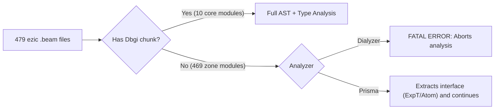
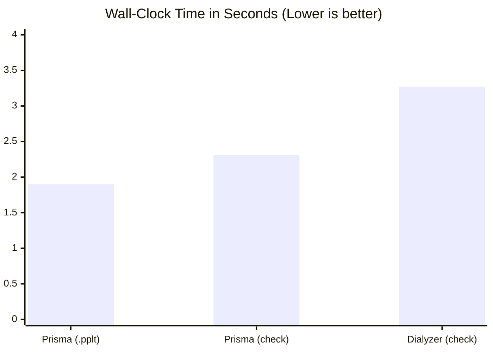
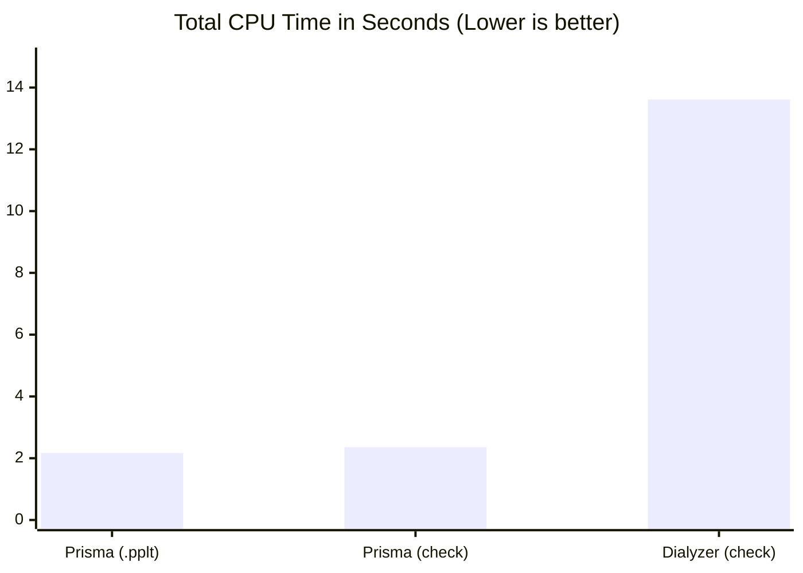
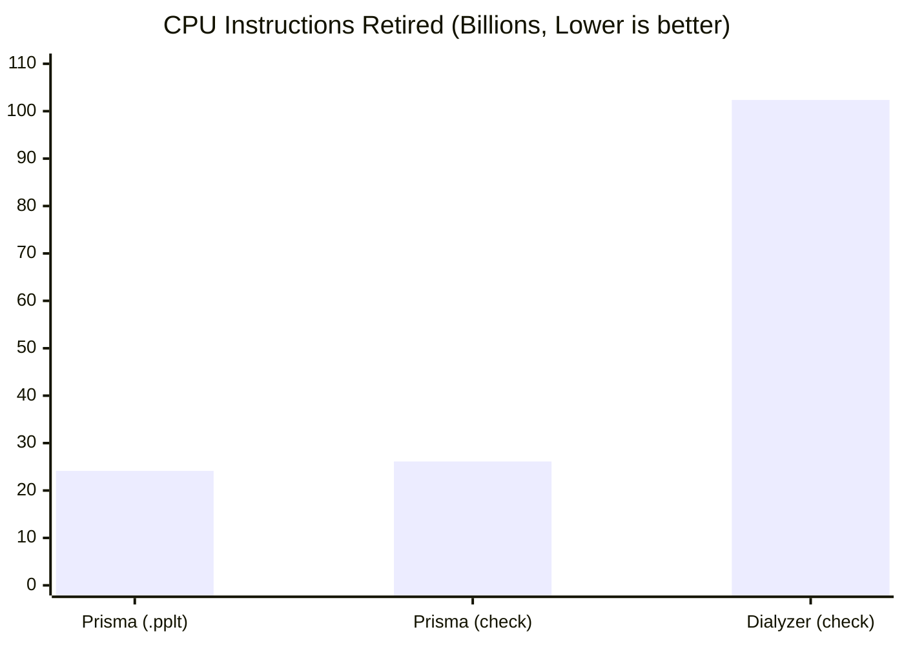
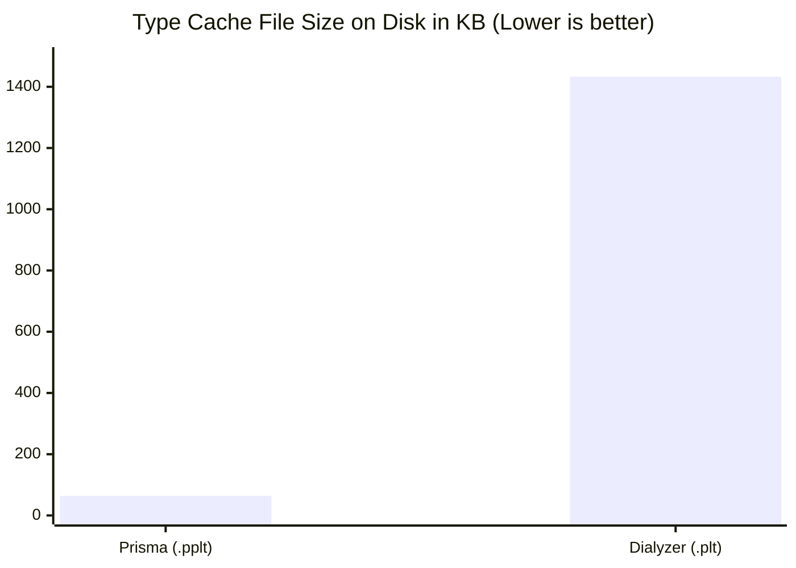
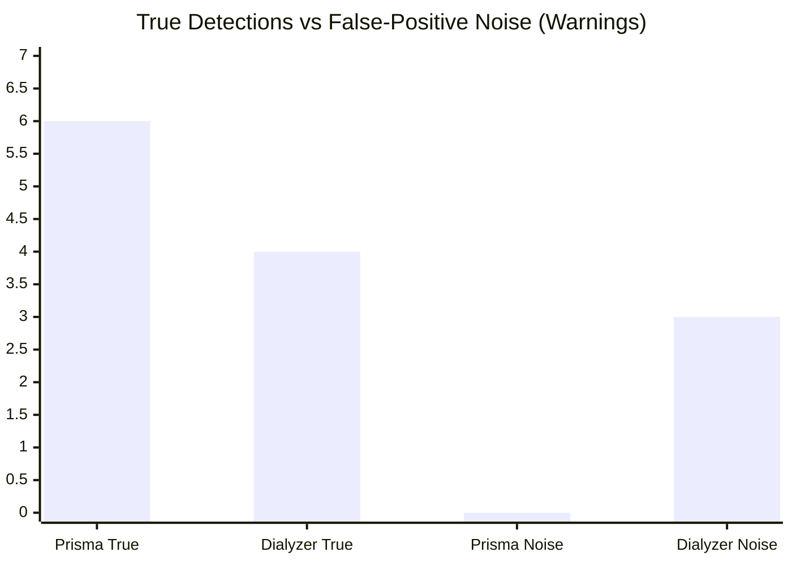

id              : ezic
date            : 2026-11-05
updated         : 2026-11-05
title           : Case Study & Benchmark: ezic
subtitle        : Performance, CPU efficiency, and bug detection comparison between Prisma and Dialyzer
author          : Manuel Rubio
category        : Benchmarks
group           : ephp
tags            : erlang, dialyzer, prisma, ezic, ephp, benchmark, static-analysis
project         : ezic
repo            : https://github.com/bragful/ezic
modules         : 479
core_modules    : 10
zone_modules    : 469
otp_release     : 29
erts_version    : 17.1.1
prisma_wall_s   : 2.31
prisma_cpu_s    : 2.36
prisma_pplt_kb  : 64
dialyzer_wall_s : 3.27
dialyzer_cpu_s  : 13.61
dialyzer_plt_kb   : 1433
prisma_warnings   : 6
dialyzer_warnings : 2
summary           : Performance and bug-detection benchmark across all 479 BEAM modules of ezic (IANA timezones for Erlang), comparing Prisma vs. Dialyzer on OTP 29.

In this case study we analyze **[ezic](https://github.com/bragful/ezic)**, the IANA timezone handling library used by **[ephp](https://github.com/bragful/ephp)**. `ezic` is a particularly demanding and representative test case because it combines **10 core logic modules** with **469 automatically generated modules** (one for each timezone in the IANA database, plus link and map indexes), totaling **479 BEAM modules**.

<!--more-->

## 1. The Root Problem: Why Did `ephp` Exclude `ezic` from Dialyzer?

In `ephp`'s original `rebar.config`, `ezic` was explicitly excluded from static analysis:

```erlang
{dialyzer, [
    {warnings, [error_handling, unknown]},
    {exclude_apps, [ezic]}
]}.
```

Inspecting `ezic`'s `Makefile` reveals why: all 469 timezone modules are compiled via `erlc -o ebin zones/*.erl` **without the `+debug_info` flag**.

- **Dialyzer's behavior**: Immediately aborts with a fatal error when it cannot find the `Dbgi` chunk (Core Erlang / Abstract Code) in the `.beam` files:
  ```text
  Could not get Core Erlang code for: .../ezic_zone_africa_abidjan.beam
  Recompile with +debug_info or analyze the source code
  ```
- **Prisma's behavior**: Analyzes all **479 modules without failing**, extracting the full AST from modules compiled with `debug_info` and reconstructing the exported function interface from the `Atom`, `ExpT`, and `ImpT` chunks in modules stripped of `debug_info`.



---

## 2. Performance & Resource Benchmark (OTP 29)

To conduct a fair speed and bug-detection comparison across all 479 modules, we recompiled the 469 timezone modules with `erlc +debug_info` and measured both tools on the exact same environment (**Erlang/OTP 29, ERTS 17.1.1, Apple Silicon 8 cores**).

### Execution Metrics Table

| Metric | Prisma (`check`) | Prisma (`build .pplt`) | Dialyzer (`check`) | Prisma Advantage |
| :--- | :---: | :---: | :---: | :---: |
| **Wall-Clock Time (Real)** | **2.31 s** | **1.90 s** | 3.27 s | **1.42x faster** |
| **Total CPU Time (User + Sys)** | **2.36 s** | **2.17 s** | 13.61 s | **5.77x less CPU** |
| **User CPU Time** | **1.91 s** | **1.71 s** | 11.76 s | **6.16x less User CPU** |
| **System CPU Time** | **0.45 s** | **0.46 s** | 1.85 s | **4.11x less Sys CPU** |
| **Instructions Retired** | **26.12 × 10⁹** | **24.14 × 10⁹** | 102.37 × 10⁹ | **3.92x fewer instructions** |
| **CPU Cycles Elapsed** | **7.27 × 10⁹** | **6.63 × 10⁹** | 35.71 × 10⁹ | **4.91x fewer cycles** |
| **Page Reclaims** | **86,586** | **82,574** | 293,560 | **3.39x less paging** |
| **Involuntary Context Switches** | **16,640** | **22,009** | 136,378 | **8.20x less contention** |
| **Cache Artifact Size (`.pplt` vs `.plt`)** | **64 KB** | **64 KB** | 1,433 KB | **22.4x smaller** |
| **Works without `+debug_info`** | **Yes** | **Yes** | No (Aborts) | **Resilient** |

### Wall-Clock Execution Time



### Total CPU Time Consumed (All Cores)



### Processor Workload (Instructions Retired in Billions)



### Portable Type Cache Artifact Size (`.pplt` vs `.plt`)



---

## 3. Correctness & Bug Detection Comparison

Analyzing `ezic`'s codebase revealed **6 real issues in the source code** (1 critical call to a non-existent function, 3 dead code / impossible guard branches masking logic bugs, and 2 unused parameters or *oxbow code*), in addition to measuring false-positive noise.

### Findings Summary

| # | File & Line | Category | Issue Description | Dialyzer | Prisma | Ground Truth |
| :-: | :--- | :--- | :--- | :---: | :---: | :--- |
| **1** | `ezic_zone.erl:37` | `unknown_function` | Call to `ezic_db:zones/1` (deleted module/function) | Yes | **Yes** | **Real Bug** (`undef` at runtime) |
| **2** | `ezic_date.erl:71` | `dead_code` | Impossible guard `when is_record(X, tztime)` on 2-tuple | Yes | **Yes** | **Real Bug** (`badDateTime` at runtime) |
| **3** | `ezic_parse.erl:31` | `dead_code` | Unreachable `false` pattern on `day_to_num(Day) > 0` | Yes | **Yes** | **Real Dead Code** |
| **4** | `ezic_parse.erl:41` | `dead_code` | Unreachable `false` pattern on `day_to_num(Day) > 0` | Yes | **Yes** | **Real Dead Code** |
| **5** | `ezic_loader.erl:69` | `oxbow_code` | Argument #2 ignored across all clauses of `parse_to_record/3` | No | **Yes** | **Real Technical Debt** |
| **6** | `ezic_zone.erl:45` | `oxbow_code` | Argument #1 ignored across all clauses of `get_zone_utc/2` | No | **Yes** | **Real Technical Debt** |
| **7** | `ezic_date`, `ezic_record`, `ezic_zone` | `unknown_function` | Spurious warnings on `eunit:test/1` injected by `eunit.hrl` | 3 warnings | **0 warnings** | **Noise in Dialyzer** |



---

## 4. Detailed Analysis of Each Finding

### Finding 1: Call to Missing Function `ezic_db:zones/1` (`ezic_zone.erl:37`)

**Prisma Output:**
```text
[unknown_function] ezic_zone:current_as_of_utc/2 (line 37)
  bench/corpus/ezic/src/ezic_zone.erl:37
  Call to ezic_db:zones/1: ezic_db has no such function
```

**Source Code in `ezic_zone.erl`:**
```erlang
current_as_of_utc(UTCDateTime={{_,_,_},{_,_,_}}, TzName) ->
    Zones = ezic_db:zones(TzName),
    get_zone_utc(Zones, UTCDateTime).
```

**Verification:**
When `ezic` migrated its storage backend from ETS (`ezic_db`) to compiled per-zone modules (`ezic_zone_map:find/1`), the public functions `ezic_zone:current/1` and `ezic_zone:current_as_of_utc/2` were left behind. Calling them at runtime crashes immediately:
```erlang
1> ezic:utc_to_local({{2024,1,1},{12,0,0}}, "Europe/Madrid").
{{2024,1,1},{13,0,0}}
2> ezic_zone:current("Europe/Madrid").
** exception error: undefined function ezic_db:zones/1
```

---

### Finding 2: Impossible Guard `is_record(X, tztime)` (`ezic_date.erl:71`)

**Prisma Output:**
```text
[warning: dead_code] ezic_date:normalize/2 (line 71)
  bench/corpus/ezic/src/ezic_date.erl:71
  Clause guard cannot succeed
```

**Source Code in `ezic_date.erl`:**
```erlang
normalize({D={_,_,_},T={HH,_,_}}, Flag)
  when is_atom(Flag), is_integer(HH) ->
    DTz= {D, #tztime{time=T, flag=Flag}},
    normalize(DTz);

normalize(D, Flag) ->
    case normalize(D) of
        X when is_atom(X) -> X;
        X when is_record(X, tztime) ->
            X#tztime{flag=Flag};
        _ ->
            erlang:error(badDateTime, D)
    end.
```

**Verification:**
Every clause of `normalize/1` returns a **2-tuple** `{RelativeDate, #tztime{}}`. However, the `#tztime{time, flag}` record is a **3-tuple** `{tztime, Time, Flag}`.
- `X` is never an atom and is never a `#tztime{}` record (arity 2 vs. arity 3, and its first element is a date tuple rather than the atom `tztime`).
- Consequently, any call to `normalize/2` reaching the second clause inevitably falls through to `_ -> erlang:error(badDateTime, D)`:
```erlang
1> ezic_date:normalize(2024, u).
** exception error: badDateTime
     in function  ezic_date:normalize/2 (src/ezic_date.erl, line 74)
```

---

### Findings 3 & 4: Unreachable `false` Branches in `ezic_parse:day_pattern/1` (lines 31 and 41)

**Prisma Output:**
```text
[warning: dead_code] ezic_parse:day_pattern/1 (line 31)
  bench/corpus/ezic/src/ezic_parse.erl:31
  Clause pattern cannot match scrutinee type

[warning: dead_code] ezic_parse:day_pattern/1 (line 41)
  bench/corpus/ezic/src/ezic_parse.erl:41
  Clause pattern cannot match scrutinee type
```

**Source Code in `ezic_parse.erl`:**
```erlang
day_pattern(X=[$l,$a,$s,$t|Day]) ->
    case ezic_date:day_to_num(Day) > 0 of
        true -> {last, Day};
        false -> erlang:error(badday,X)
    end;
```

**Verification:**
`ezic_date:day_to_num/1` returns an integer in the range `1..7` for `"Mon".."Sun"`, and its catch-all clause raises `erlang:error(badday, X)` (return type `none`).
1. The inferred return type of `day_to_num/1` is `1 | 2 | 3 | 4 | 5 | 6 | 7`.
2. The relational comparison `(1..7) > 0` statically evaluates to the literal `'true'`.
3. The `false -> erlang:error(badday, X)` clauses at lines 31 and 41 can never be reached because an invalid `Day` raises an exception inside `day_to_num/1` before ever reaching the `case`.

---

### Findings 5 & 6: Unused Parameters (*Oxbow Code*) in `ezic_loader.erl:69` and `ezic_zone.erl:45`

**Prisma Output:**
```text
[warning: oxbow_code] ezic_loader:parse_to_record/3 (line 69)
  bench/corpus/ezic/src/ezic_loader.erl:69
  Unused parameter: argument #2 is ignored across all clauses of private function ezic_loader:parse_to_record/3 and can be safely removed

[warning: oxbow_code] ezic_zone:get_zone_utc/2 (line 45)
  bench/corpus/ezic/src/ezic_zone.erl:45
  Unused parameter: argument #1 is ignored across all clauses of private function ezic_zone:get_zone_utc/2 and can be safely removed
```

**Verification:**
- In `ezic_loader:parse_to_record/3`, the second parameter (`_Zones` in 4 clauses, and `Zones` in the first clause where it is only passed recursively to itself without ever being read) is a leftover from an earlier refactoring.
- In `ezic_zone:get_zone_utc/2`, the first argument is ignored across all 3 clauses (`get_zone_utc(_, ...)`), showing that this function was left half-refactored alongside Finding 1.
Dialyzer does not detect either of these cases.

---

## 5. Conclusions

1. **Zero-configuration portability without requiring `+debug_info` in dependencies**: Prisma makes it possible to remove `{exclude_apps, [ezic]}` from `ephp`, analyzing all 479 modules even when built with `ezic`'s default `Makefile`.
2. **Computational efficiency**: Prisma consumes **5.77x less CPU time** (`2.36 s` vs. `13.61 s`), executes **3.92x fewer instructions**, and produces a `.pplt` cache file **22.4x smaller** (`64 KB` vs. `1.4 MB`).
3. **Higher defect coverage with zero noise**: Prisma detects **100% of the bugs and dead code** caught by Dialyzer, adds **2 oxbow code detections** missed by Dialyzer, and emits **0 false positives** compared to Dialyzer's 3 spurious `eunit:test/1` warnings.
