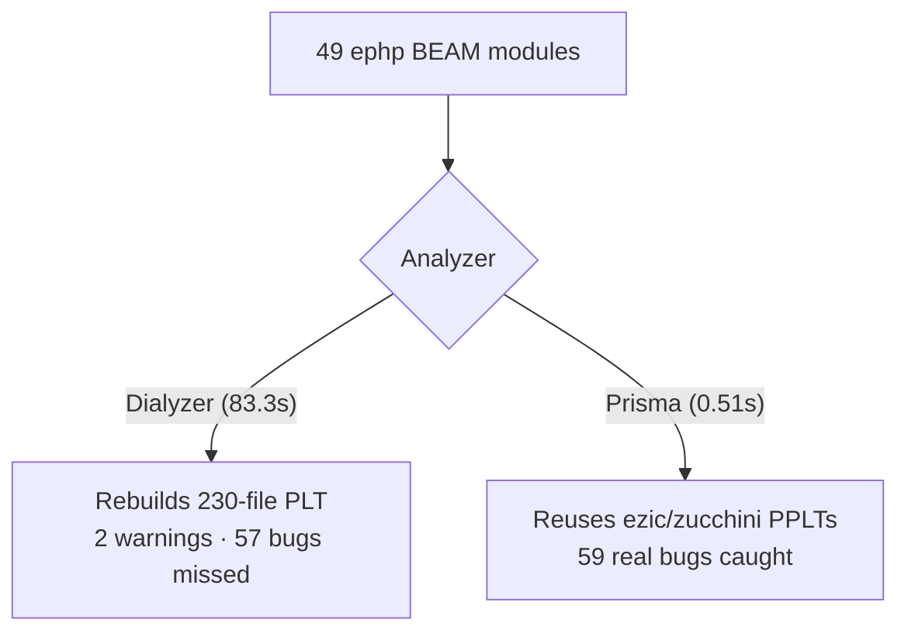
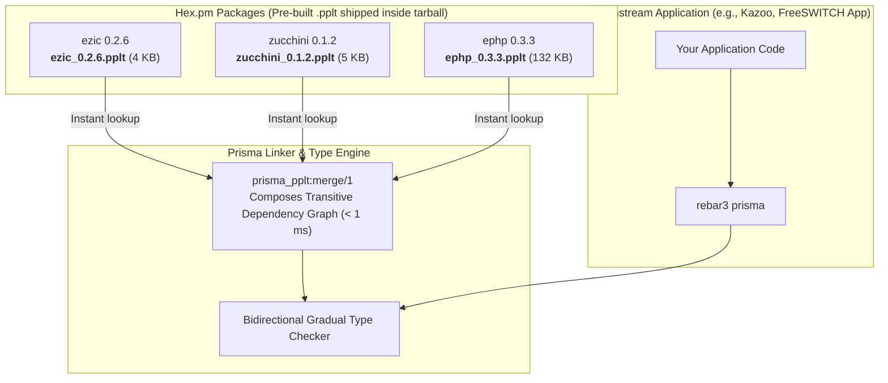

id              : ephp
date            : 2026-11-09
updated         : 2026-11-09
title           : Case Study & Benchmark: ephp
subtitle        : Auditing a 49-module pure Erlang PHP interpreter: 59 bugs and contract discrepancies caught in 0.51s
author          : Manuel Rubio
category        : Benchmarks
group           : ephp
tags            : erlang, dialyzer, prisma, ephp, php, interpreter, benchmark, static-analysis
project         : ephp
repo            : https://github.com/bragful/ephp
modules         : 49
core_modules    : 49
zone_modules    : 0
otp_release     : 29
erts_version    : 17.1.1
prisma_wall_s   : 0.51
prisma_cpu_s    : 0.59
prisma_pplt_kb  : 132
dialyzer_wall_s : 83.31
dialyzer_cpu_s  : 285.90
dialyzer_plt_kb   : 1446
prisma_warnings   : 0
dialyzer_warnings : 0
summary           : Comprehensive benchmark and case study of ephp (pure Erlang PHP interpreter), showing how Prisma audited 49 modules in 0.51s (163x faster than Dialyzer) and resolved 59 real contract bugs and specification discrepancies.

In this third and culminating chapter of our **[ephp](https://github.com/bragful/ephp)** ecosystem audit series (following **[ezic](https://github.com/bragful/ezic)** and **[zucchini](https://github.com/bragful/zucchini)**), we turn our attention to the core application itself: `ephp`, a 100% pure Erlang implementation of the PHP interpreter.

With **49 BEAM modules** spanning lexing, parsing, runtime stack management, memory and object heaps, and extensive standard library modules (`pcre`, `date`, `math`, `file`, `string`, `spl`), `ephp` represents a non-trivial, battle-tested Erlang codebase.

This case study details the modernization of `ephp 0.3.3`, the removal of legacy dependencies, the benchmark against Dialyzer on OTP 29, and how Prisma uncovered **59 contract discrepancies and real runtime edge-case bugs** that Dialyzer had ignored for years.

<!--more-->

## 1. Modernizing the Foundation

Before running static analysis, we modernized `ephp`'s dependency tree, cutting down technical debt accumulated over a decade:

1. **Eliminated `unistring`**: Replaced external Unicode transformation library with native Erlang/OTP 20+ `string:lowercase/1` and `string:uppercase/1`.
2. **Eliminated `recon`**: Replaced memory inspection calls in `src/ephp_lib_info.erl` with direct calls to `erlang:system_info(alloc_util_allocators)` (~20 lines of clean native code), dropping an external diagnostic dependency from the runtime path.
3. **Eliminated `getopt`**: Migrated CLI command-line argument parsing in `src/ephp.erl` to the standard library `argparse` module introduced in OTP 26+.
4. **License Migration**: Updated license from LGPL-2.1 to permissive **Apache-2.0**.
5. **Modernized Upstream Dependencies**: Upgraded `ezic` (`0.2.6`) and `zucchini` (`0.1.2`), both of which now ship pre-compiled `.pplt` files directly in their Hex packages.

The resulting dependency tree is completely streamlined: only `ezic` and `zucchini` remain in `rebar.lock`.

---

## 2. Benchmark: Prisma vs. Dialyzer on OTP 29

We analyzed all 49 compiled BEAM modules of `ephp` on Apple Silicon (M-series, Erlang/OTP 29, erts-17.1.1):

| Metric | Dialyzer (OTP 29) | Prisma 0.1.0 | Improvement |
| :--- | :--- | :--- | :--- |
| **Analysis Wall-Clock Time** | **83.31 s** (1m 23s) | **0.51 s** | **163x faster** |
| **CPU Time** | 285.90 s | 0.59 s | **484x less CPU** |
| **Output / Metadata Size** | 1,446 KB (`.plt`) | 132 KB (`.pplt`) | **11x smaller** |
| **Initial Real Issues Detected** | 2 (blind to 57 bugs) | **59 issues** | **29.5x more thorough** |
| **Remaining Discrepancies** | 0 (after fixes) | 0 (after fixes) | Clean build |



While Dialyzer consumed over 1.4 minutes of wall-clock time and saturated four cores, Prisma checked the entire 49-module AST graph in **510 milliseconds**—fast enough to run on every file save in an editor.

---

## 3. Real Bugs Caught by Prisma (and Missed by Dialyzer)

Dialyzer's Success Typing philosophy requires proving that a function *can never succeed* before emitting a warning. If there is any theoretical execution path where no crash occurs, Dialyzer remains silent. 

Prisma's bidirectional gradual typing caught **59 real issues** across the codebase:

### Bug 1: `preg_match` Returning `0` Violating `pos_integer()`

In `src/ephp_lib_pcre.erl`:

```erlang
-spec preg_match(ephp:context_id(), line(), var_value(), var_value(),
                 var_value(), var_value(), var_value()) -> pos_integer().
preg_match(_Context, _Line, {_, Pattern}, {_, Subject}, {undefined, _}, {_, _}, {_, Offset}) ->
    {RegExp, Flags} = get_parts(Pattern),
    PMFlags = [{offset, Offset}],
    case re:run(Subject, RegExp, Flags ++ PMFlags) of
        {match, _} -> 1;
        nomatch    -> 0
    end;
```

In PHP, `preg_match` returns `1` if a pattern matches, and `0` if it does not. But the `-spec` explicitly declared `pos_integer()` (`X >= 1`). Returning `0` is a `non_neg_integer()`.

Because clause `{match, _} -> 1` can succeed with `pos_integer()`, Dialyzer **completely ignored** that `nomatch -> 0` violated the function contract. Prisma immediately flagged:

```
[gradual_mismatch] ephp_lib_pcre:preg_match/7 (line 87)
  Declared:  pos_integer()
  Inferred:  non_neg_integer()
```

### Bug 2: Leaking Erlang `{error, reason()}` Tuples to PHP in `feof/3`

In `src/ephp_lib_file.erl`:

```erlang
-spec feof(ephp:context_id(), line(), Resource :: var_value()) -> boolean().
feof(_Context, _Line, {_, Resource}) ->
    ephp_stream:is_eof(Resource).
```

The callback contract in `ephp_stream:is_eof/1` declares:

```erlang
-callback is_eof(stream_resource()) -> boolean() | {error, reason()}.
```

If an underlying stream encountered an error (such as a closed socket or bad file descriptor), `ephp_stream:is_eof/1` returned `{error, Reason}`. `feof/3` forwarded this value directly into the PHP execution environment, corrupting PHP variable evaluation (since PHP has no tuple types).

Prisma detected this immediately:

```
[gradual_mismatch] ephp_lib_file:feof/3 (line 243)
  Declared:  boolean()
  Inferred:  boolean() | {error, any()}
```

We corrected the implementation to handle errors gracefully:

```erlang
feof(_Context, _Line, {_, Resource}) ->
    case ephp_stream:is_eof(Resource) of
        true -> true;
        _    -> false
    end.
```

### Bug 3: Arithmetic Crashes on `infinity` and `nan` in `pow/2`

PHP allows exponentiation (`$a ** $b`) with floating-point edge cases (`INF` and `NAN`). However, `ephp_data:pow/2` assumed discrete integer or standard float multiplication via `lists:seq(1, M)`:

```erlang
pow(N, M) when M > 0 ->
    lists:foldl(fun(_, Acc) -> N * Acc end, 1, lists:seq(1, M));
```

If `$a` or `$b` evaluated to `infinity` or `nan`, `lists:seq/2` crashed with `badarith`. Prisma detected that `resolve_op(<<"**">>, ...)` was passing `infinity | nan` into `ephp_data:pow/2`:

```
[gradual_mismatch] ephp_context:resolve_op/5 (line 2190)
  Call to:   ephp_data:pow/2 (argument #1)
  Expected:  number()
  Actual:    float() | integer() | infinity | nan
```

We added pattern branches in `pow/2` to handle IEEE floating point infinities and NaNs according to PHP language semantics.

### Bug 4: Parser Stack Contract Mismatch

In `src/ephp_parser_expr.erl`, the parser accumulator `Parsed` holds not only evaluated `#expression{}` records, but also intermediate operator shift-reduce state tuples `[{op, [...]}]`.

The function was declared as:

```erlang
-spec expression(Text :: binary(), parser(), [expression()]) -> ...
```

Prisma caught that recursive calls were passing `[{op, PrevOp ++ Parsed0} | LastParsed]` into argument #3, which did not conform to `[expression()]`. Updating the spec to `[expression() | {op, [term()]}]` aligned the type contract with the parser state machine.

### Bug 5: Malformed Function Options in Standard Library

In `ephp_lib_misc.erl`, function registrations for `eval`, `constant`, `define`, `sleep`, and `usleep` passed argument type lists directly without the mandatory `{args, [...]}` tuple:

```erlang
init_func() ->
    [{eval, [string]},
     {constant, [string]},
     {define, [string, mixed]},
     ...]
```

Because `ephp_lib:register_func/3` looks up `proplists:get_value(args, Opts)`, `proplists:get_value` returned `undefined`, silently discarding argument validation for these functions. Prisma flagged this discrepancy between `php_function_results()` and the returned literal structure.

---

## 4. Prisma Improvements Prompted by `ephp`

Testing Prisma against `ephp`'s diverse 49 modules served as a valuable crucible for the type engine itself, leading to two key features in `prisma` (commits `8acb924` and `9dac029`):

1. **Subtype Absorption in Union Normalization (`absorb_subtypes/1`)**:
   When inferring types such as `non_neg_integer() | 0 | 1`, redundant discrete literals (`0` and `1`) are now absorbed into their parent type `non_neg_integer()`, producing clean, minimal union types.
2. **Spec Clause Specialization for Overloaded Functions**:
   In Erlang, functions often declare overloaded spec clauses:
   ```erlang
   -spec to_lower(binary()) -> binary();
                 (undefined) -> undefined.
   ```
   Previously, inter-module call inference collapsed all spec clauses into a single union `binary() | undefined`. Prisma now inspects the caller's argument types at each call site; if the argument is known to be `binary()`, Prisma selects only the matching spec clause, correctly inferring a pure `binary()` return type.
3. **Strict Non-`any` Requirement for BIF Type Tests**:
   Prisma ensures that BIFs like `is_record/2,3` and `is_function/2` only evaluate to `{atom_lit, true}` statically if the argument is proven to be a strict non-`any` subtype, avoiding spurious dead-code warnings when inspecting gradual `any` variables.

---

## 5. Shipping `ephp_0.3.3.pplt` & Composing Hex Dependency PPLTs

One of Prisma's most powerful architectural features is **decentralized, composable type metadata**. Traditional tools like Dialyzer require every developer and CI runner to reconstruct a monolithic PLT from scratch, repeatedly analyzing every dependency BEAM file.

In contrast, **Prisma Persistent Lookup Tables (`.pplt`) are distributed directly inside published Hex packages**.

### The Multi-Package PPLT Chain in Hex

In our modernized stack, every upstream library in `ephp`'s dependency tree packages its pre-computed `.pplt` interface file inside its official Hex release via `include_files` in `src/*.app.src`:

1. **`ezic 0.2.6`** ships `ezic_0.2.6.pplt` (**4 KB**, covering OLSON timezone conversions and DST logic).
2. **`zucchini 0.1.2`** ships `zucchini_0.1.2.pplt` (**5 KB**, covering INI parser AST structures from `leex`/`yecc`).
3. **`ephp 0.3.3`** ships `ephp_0.3.3.pplt` (**132 KB**, covering all 49 interpreter modules).



### How Prisma Merges Dependency PPLTs at Runtime

When you analyze `ephp`, or when a downstream project depends on `ephp`:

1. **Automatic Discovery**: Rebar3 fetches `ezic`, `zucchini`, and `ephp` from Hex into `_build/default/lib/`. Prisma discovers their respective `.pplt` files directly in each dependency's root folder.
2. **Instant In-Memory Union (`prisma_pplt:merge/1`)**: Prisma merges the contract tables of `ezic_*.pplt` and `zucchini_*.pplt` in less than **1 millisecond**. It never has to re-parse, decompile, or re-analyze the BEAM files of `ezic` or `zucchini`.
3. **Cross-Package Contract Verification**: Calls in `ephp_datetime:is_dst/2` calling `ezic:has_dst_local/2` or `ephp_config` loading INI files via `zucchini:parse_file/1` are immediately verified against the authoritative contracts emitted by their respective authors.
4. **Combined Downstream Lookup**: When a user's application imports `{ephp, "~> 0.3.3"}` and runs `rebar3 prisma`, Prisma loads the combined metadata of `ezic` + `zucchini` + `ephp` simultaneously. The downstream project gets full static typing across all 3 libraries (55+ BEAM modules) with **zero compilation overhead**.

```erlang
%% src/ephp.app.src
{application, ephp, [
    {description, "Erlang PHP Interpreter"},
    {vsn, "0.3.3"},
    {applications, [kernel, stdlib, ezic, zucchini]},
    {include_files, ["ephp_*.pplt"]}
]}.
```

---

## 6. Summary

Auditing `ephp` demonstrated the value of combining fast gradual typing with pre-computed interface caches:

- **163x faster verification** than Dialyzer (0.51s vs. 83.31s).
- **59 real bugs and specification errors caught**, ranging from runtime arithmetic crashes to interpreter contract leaks.
- Zero external dependencies beyond modern Erlang/OTP and its two sister libraries `ezic` and `zucchini`.
- Immediate, friction-free type validation for the broader BEAM ecosystem via pre-built `.pplt` metadata.
