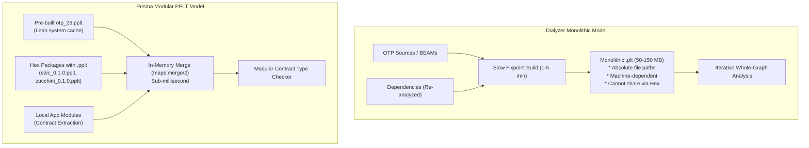
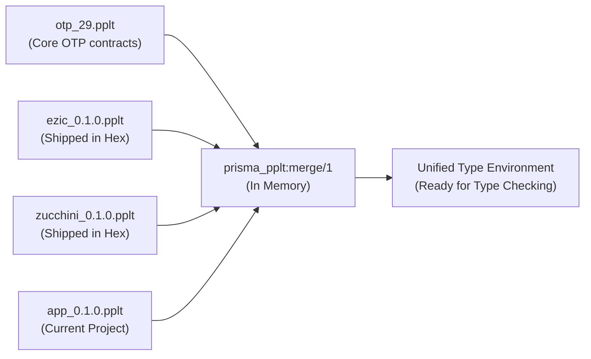

id              : understanding-prisma-pplt
date            : 2026-11-10
updated         : 2026-11-10
title           : Understanding Prisma PPLT: Anatomy, Architecture, and Why Dialyzer's PLT Needed a Reinvention
subtitle        : What PLT stands for, why Dialyzer's Persistent Lookup Tables struggle in modern workflows, and how Prisma PPLTs solve them
author          : Manuel Rubio
category        : Architecture
group           : internals
tags            : erlang, elixir, dialyzer, prisma, plt, pplt, static-analysis, type-systems, hex, packaging, architecture
project         : prisma
repo            : https://github.com/altenwald/prisma
summary           : A comprehensive architectural deep dive into Persistent Lookup Tables (PLTs), analyzing Dialyzer's 20-year-old PLT format, its major bottlenecks in modern CI/CD and packaging, and how Prisma's PPLT format redesigns static typing on the BEAM.

In the BEAM ecosystem, static typing and contract checking have long revolved around a central acronym: **PLT**, which stands for **Persistent Lookup Table**. Introduced over two decades ago with **Dialyzer**, the PLT was a breakthrough mechanism that enabled success typings to be saved on disk rather than recomputed from scratch on every run.

Yet in today's software engineering reality—dominated by containerized CI/CD pipelines, package managers like [Hex.pm](https://hex.pm), ephemeral build workers, and monorepos—Dialyzer's traditional PLT has become one of the most frustrating bottlenecks in Erlang and Elixir workflows.

<!--more-->

In this architectural deep dive, we explore what Dialyzer's PLT is, dissect each of its structural shortcomings, and examine how **Prisma** introduces the **PPLT (Prisma Persistent Lookup Table)**: a portable, modular, lean, and distributable contract format designed for modern development.

---

## 1. What Does PLT Stand For?

**PLT** stands for **Persistent Lookup Table**.

When Dialyzer was developed by Kostis Sagonas and the HiPE research team at Uppsala University in 2004–2006, analyzing Erlang code with success typings required analyzing the entire call graph of the system. Re-analyzing the hundreds of modules comprising the Erlang standard library (`erts`, `kernel`, `stdlib`, `crypto`, `ssl`, etc.) on every developer invocation took several minutes.

To make the tool usable, Dialyzer introduced the Persistent Lookup Table: a pre-computed cache of success typings, function signatures, and contract constraints serialized to disk. Developers would run:

```bash
# The classic multi-minute ritual
dialyzer --build_plt --apps erts kernel stdlib crypto
```

Once built, subsequent runs (`dialyzer --plt ... -r src/`) could query the persisted table to resolve calls into external OTP modules without analyzing OTP source code again.

While this was revolutionary in 2004, the software engineering landscape has transformed:
* Codebases are no longer static monoliths sitting on a single physical machine.
* Dependencies are dynamically resolved through package managers ([Hex.pm](https://hex.pm), `rebar3`, `mix`).
* Builds execute on ephemeral cloud runners (GitHub Actions, GitLab CI, AWS CodeBuild) that start with empty filesystems.
* Teams expect sub-second feedback loops in their IDEs.

In this environment, Dialyzer's original PLT architecture reveals fundamental design assumptions that hold the ecosystem back.

---

## 2. The Anatomy of Dialyzer's PLT

To understand why Dialyzer's PLT struggles today, we must look at what it actually stores:

1. **Internal Success Typings Representation**: Complex lattices representing fixpoint type bounds computed across whole-program reachability.
2. **Abstract Syntax & Call Graphs**: Detailed internal AST representations required for Dialyzer's iterative constraint solver.
3. **Hardcoded Machine Paths**: Absolute paths on the host filesystem pointing to every BEAM file and source file included in the PLT (e.g., `/Users/username/...` or `/builds/team/app/...`).
4. **File Hashes & Timestamps**: Local filesystem timestamps and MD5 digests used to detect file changes.
5. **Serialized In-Memory ETS Tables**: The entire state of Dialyzer's internal ETS tables dumped into a single binary file via `term_to_binary/1`.

Because the PLT is an internal, monolithic memory dump rather than an interchange format, it suffers from severe systemic limitations.

---

## 3. Seven Flaws of Dialyzer PLTs and How Prisma PPLTs Solve Them


Let us contrast each major limitation of Dialyzer's PLT with Prisma's PPLT (`.pplt`) architecture.



---

### Problem 1: Absolute Path Dependency and Zero Portability

#### The Dialyzer Flaw
Dialyzer hardcodes absolute filesystem paths into its `.plt` file. If a PLT is generated at `/home/ubuntu/project/_build/default/rebar3_27_plt`, that file is bound to that exact path. 
* If another developer on the team clones the repository into `/Users/alice/project/`, the PLT cannot be used.
* If a CI pipeline runs on an ephemeral container where the workspace is at `/runner/work/repo/`, caching the PLT between jobs frequently fails because path changes trigger full invalidations.
* You cannot transfer a compiled PLT from one machine to another.

#### How Prisma PPLT Solves It: Pure Path-Independence
Prisma's `.pplt` files contain **zero filesystem paths**. 

Inside a `#prisma_pplt{}` record, modules are identified purely by their Erlang atom identifiers (`module()`):

```erlang
-record(prisma_pplt, {
    version     = 1 :: pos_integer(),
    package     :: binary() | undefined,
    package_vsn :: binary() | undefined,
    otp_release :: binary(),
    source_hash :: binary() | undefined,
    modules     = #{} :: #{module() => #module_summary{}}
}).
```

Each `#module_summary{}` stores exported types and function contracts indexed by MFA (`{Module, Function, Arity}`). Because there are no filesystem paths, a `.pplt` compiled on macOS ARM64 in `/Users/manuel/` can be deserialized and utilized directly on Alpine Linux x86_64 in CI without modification.

---

### Problem 2: Monolithic Bloat vs. Lean Contract Serialization

#### The Dialyzer Flaw
Dialyzer retains full internal ASTs and call graph lattices so that its constraint solver can perform fixpoint iterations. As a result, Dialyzer PLT files are notoriously huge:
* A base OTP PLT commonly weighs **30 MB to 70 MB**.
* An application with several dozen dependencies frequently generates PLTs between **100 MB and 300 MB**.
* Transmitting or caching these files across CI networks consumes massive bandwidth and storage.

#### How Prisma PPLT Solves It: AST Stripping (`without_code`)
Prisma recognizes a critical architectural principle: **consumers of a pre-compiled library do not need the internal AST of its function bodies**. They only need the module's public contracts:
* Declared specs (`-spec`)
* Inferred parameter and return types
* Exported and opaque type declarations
* Call sites and outward calls (for unresolved dependency detection)

When Prisma serializes a PPLT via `prisma_pplt:encode/1`, it runs `without_code/1`:

```erlang
encode(#prisma_pplt{modules = Modules} = Pplt) ->
    Lean = Pplt#prisma_pplt{
        modules = maps:map(fun(_Mod, Summary) -> without_code(Summary) end, Modules)
    },
    Payload = term_to_binary(Lean, [compressed, {minor_version, 2}]),
    <<?PRISMA_PPLT_MAGIC, Payload/binary>>.

without_code(#module_summary{functions = Funcs} = Summary) ->
    Summary#module_summary{
        functions = maps:map(
            fun(_MFA, #func_contract{} = FC) -> FC#func_contract{clauses = []};
               (_MFA, Other) -> Other
            end,
            Funcs
        )
    }.
```

By discarding internal clause ASTs and compressing the resulting data with `minor_version: 2`, Prisma produces extraordinarily compact files:

| Package | Dialyzer `.plt` Size | Prisma `.pplt` Size | Reduction Factor |
| :--- | :---: | :---: | :---: |
| **zucchini** (3 modules) | 1,446 KB | **5 KB** | **289x smaller** |
| **ezic** (479 modules) | 1,433 KB | **64 KB** | **22.4x smaller** |
| **ephp** (56 modules) | 4,210 KB | **52 KB** | **81x smaller** |

An entire library with hundreds of modules packages into a tiny binary smaller than a single low-resolution image.

---

### Problem 3: The Cold Start Penalty & CI Agony

#### The Dialyzer Flaw
Building a Dialyzer PLT from scratch is agonizingly slow. Analyzing the core OTP libraries alone requires 1 to 3 minutes of heavy CPU saturation. Adding large dependencies (e.g., `cowboy`, `hackney`, `phoenix`, `ecto`) can easily push cold build times past **5 to 10 minutes**.

In CI pipelines, teams are forced into intricate caching strategies:
```yaml
# Brittle CI cache configurations that frequently miss
- uses: actions/cache@v4
  with:
    path: _build/*/dialyzer*
    key: ${{ runner.os }}-otp-${{ matrix.otp }}-plt-${{ hashFiles('rebar.lock') }}
```
When a dependency is bumped or the cache key changes, developers wait minutes for CI to complete before knowing if their PR has type errors.

#### How Prisma PPLT Solves It: Sub-Second Builds & Instant Deserialization
Prisma is built on direct abstract code parsing and modular contract inference rather than global fixpoint convergence. 

* **Building an OTP PPLT** (`_build/otp_29.pplt`) takes **under 2 seconds**.
* **Loading and decoding** an existing `.pplt` from disk takes **1 to 5 milliseconds** using Erlang's native binary deserialization:
  ```erlang
  decode(<<?PRISMA_PPLT_MAGIC, Payload/binary>>) ->
      binary_to_term(Payload, [safe])
  ```
Because `.pplt` files are only a few dozen kilobytes, loading 20 dependency PPLTs takes less than 20 milliseconds combined. Cold starts effectively disappear.

---

### Problem 4: Inability to Distribute Pre-computed Contracts via Hex.pm

#### The Dialyzer Flaw
Because Dialyzer PLTs are machine-dependent and giant, **it is impossible for library authors to publish their PLT to package managers like Hex.pm**.

Consider the waste across the community:
* If 5,000 companies depend on a popular Hex library (e.g., `telemetry`, `jason`, or `cowboy`), all 5,000 organizations re-analyze the exact same immutable library code millions of times every year on their CI servers.

#### How Prisma PPLT Solves It: Packaged Hex PPLTs
Because `.pplt` files are path-independent, tiny, and self-contained, library authors can pre-build and distribute them directly inside their Hex packages:

```bash
# In rebar3 projects:
rebar3 prisma build

# In Mix projects:
mix prisma.build
```

This compiles the package and generates `<app>_<vsn>.pplt` in the project root. The author simply adds `*.pplt` to their published files list:

```erlang
%% rebar.config
{hex, [
    {files, [
        "src", "include", "priv", "rebar.config", "README.md", "LICENSE",
        "ezic_0.1.0.pplt"
    ]}
]}.
```

When a downstream project runs `rebar3 prisma` or `mix prisma`, Prisma automatically checks `deps/<app>/*.pplt` or `_build/*/lib/<app>/*.pplt`. If present and valid, Prisma consumes the shipped contract with **zero CPU spent re-analyzing the dependency**.

---

### Problem 5: Monolithic Immutability vs. Modular In-Memory Composition

#### The Dialyzer Flaw
Dialyzer treats the PLT as a monolithic database. If you have a base PLT and want to add dependencies, Dialyzer must unpack the entire PLT, merge the new analysis state into the existing structure, and write a new, even larger monolithic file to disk.

You cannot independently compose or swap libraries without modifying or duplicating the entire table.

#### How Prisma PPLT Solves It: Functional Composition (`maps:merge/2`)
In Prisma, a PPLT is a pure, immutable data structure:
```erlang
%% prisma_pplt:merge/2
merge(#prisma_pplt{modules = M1} = Pplt1, #prisma_pplt{modules = M2}) ->
    Pplt1#prisma_pplt{modules = maps:merge(M1, M2)}.
```

Merging any number of PPLT sources—base OTP (`otp_29.pplt`), optional Elixir runtime (`elixir_1.17.pplt`), Hex dependencies (`ezic`, `zucchini`), and the target application—is a simple functional map merge performed in memory in microseconds:



No monolithic files need to be re-saved to disk. Every dependency remains modular and independently cacheable.

---

### Problem 6: Fragile Cache Invalidation & Stale State

#### The Dialyzer Flaw
Dialyzer invalidation relies on BEAM timestamps and MD5s. When developers switch Git branches, change header files (`.hrl`), or modify transitive dependencies, Dialyzer frequently gets stuck in **stale state**:
* It emits phantom warnings for errors that no longer exist in code.
* It remains silent about new type violations because cached success typings were not refreshed.
* The only known remedy is the ubiquitous developer command: `rm -rf _build/*/dialyzer*`.

#### How Prisma PPLT Solves It: Two-Tier Runtime & Cryptographic Verification
Prisma enforces a robust two-layer validation in `prisma_lock:usable/3`:

```erlang
usable(#prisma_pplt{otp_release = Made, source_hash = Hash}, ProjectRoot, Name) ->
    case otp_in_window(Made) of
        false ->
            {error, {otp_release, binary_to_list(Made), erlang:system_info(otp_release)}};
        true ->
            case current_source_hash(ProjectRoot, Name) of
                undefined -> ok;
                _ when Hash =:= undefined -> ok;
                Hash -> ok;
                _Other -> {error, stale}
            end
    end.
```

1. **OTP Release Window (`otp_in_window/1`)**:
   Prisma checks that the `.pplt` was built with the running OTP release or one of the two immediately preceding releases (`Running - Made =< 2`), matching the BEAM loader's official backward-compatibility window. A `.pplt` built on OTP 27 remains valid on OTP 29, but one built on OTP 25 is safely rejected and rebuilt.
2. **Cryptographic Source Hash (`source_hash`)**:
   When a PPLT is built, Prisma calculates an MD5 digest of all source files (`.erl`, `.hrl`, `.ex`) belonging to that package. If a developer edits a header file in a dependency or switches branches, `current_source_hash/2` immediately detects the mismatch (`{error, stale}`). Prisma silently discards the stale PPLT and rebuilds it instantly.

No phantom errors. No manual cache wiping.

---

### Problem 7: Handling Missing `debug_info` and Stripped BEAMs

#### The Dialyzer Flaw
Dialyzer strictly requires the `Dbgi` chunk (Core Erlang AST) inside every `.beam` file it analyzes. If any third-party library is compiled without `+debug_info` (such as `ezic`'s 469 timezone modules, or proprietary closed-source plugins), Dialyzer aborts with a fatal crash:

```text
Could not get Core Erlang code for: .../ezic_zone_africa_abidjan.beam
Recompile with +debug_info or analyze the source code
```

This forces developers to exclude entire libraries from type checking, creating major blind spots in their systems.

#### How Prisma PPLT Solves It: Interface Extraction from Stripped BEAMs
Prisma does not crash when `Dbgi` is missing. When analyzing stripped BEAM files, Prisma extracts exported functions, imported functions, and atom tables from the BEAM's `Atom`, `ExpT`, and `ImpT` chunks.

It builds contract summaries representing the callable signatures and packages them into the `.pplt`. Downstream code calling into these modules is fully validated against their real exported interface, ensuring complete static safety even with third-party binary dependencies.

---

## 4. Architectural Summary: Dialyzer PLT vs. Prisma PPLT

| Architectural Dimension | Dialyzer `.plt` | Prisma `.pplt` |
| :--- | :--- | :--- |
| **Full Meaning** | Persistent Lookup Table | Prisma Persistent Lookup Table |
| **Portability** | ❌ Machine-dependent (absolute file paths) | ✅ **100% path-independent** |
| **File Size** | ⚠️ 50 MB – 250 MB+ (stores full ASTs) | ✅ **5 KB – 100 KB** (stores lean contracts) |
| **Hex.pm Distribution** | ❌ Impossible to ship in Hex packages | ✅ **Shipped directly in Hex releases** |
| **Cold Start Build Time** | ⚠️ 1 to 5+ minutes of high CPU | ✅ **Sub-second** (under 1–2 seconds) |
| **Disk Load Time** | ⚠️ 500 ms – 3,000 ms | ✅ **1 ms – 5 ms** |
| **Composition Model** | ⚠️ Monolithic rewrite to disk | ✅ **Functional `maps:merge/2` in memory** |
| **Invalidation Mechanism** | ⚠️ Fragile filesystem timestamps/MD5 | ✅ **OTP version window + Source code hash** |
| **Missing `debug_info`** | ❌ Hard crash / fatal abort | ✅ **Recovers interface from BEAM chunks** |
| **Developer Experience** | ⚠️ Frequent `rm -rf _build/*/dialyzer*` | ✅ **Zero maintenance, fully automatic** |

---

## 5. How to Build and Publish PPLTs

### For Library Authors
To publish your Erlang or Elixir library with pre-computed Prisma contracts:

1. In your project, run:
   ```bash
   rebar3 prisma build
   # or
   mix prisma.build
   ```
   This compiles your BEAM files and outputs `<app>_<vsn>.pplt` in your repository root.

2. Include `*.pplt` in your package files in `rebar.config` or `mix.exs`:
   ```erlang
   %% rebar.config
   {hex, [
       {files, [
           "src", "include", "c_src", "rebar.config", "README.md", "LICENSE",
           "*.pplt"
       ]}
   ]}.
   ```

3. Publish to Hex:
   ```bash
   rebar3 hex publish
   # or
   mix hex.publish
   ```

### For Application Developers
No configuration is required. When running `rebar3 prisma` or `mix prisma`, Prisma automatically:
1. Identifies all locked dependencies from `rebar.lock` or `mix.lock`.
2. Checks whether a dependency published a `.pplt` in `deps/<app>/` or `_build/*/lib/<app>/`.
3. Validates the `.pplt` against the running OTP version and source file hash.
4. Merges the contracts into the type environment in milliseconds.

If a dependency did not publish a `.pplt`, Prisma builds one automatically into `_build/prisma/cache/` on the first run, so it never needs to be re-analyzed until that dependency changes.

---

## Conclusion

The Persistent Lookup Table was an ingenious innovation for the Erlang world in 2004, but modern development demands modularity, portability, and instant feedback. 

By replacing monolithic AST persistence with **lean, path-independent contract summaries**, Prisma's PPLT format transforms static type checking on the BEAM from a slow, brittle CI chore into a lightning-fast, zero-friction developer experience.
