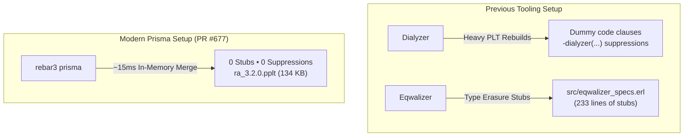

id              : ra
date            : 2026-11-13
updated         : 2026-11-13
title           : Case Study & Modernization: ra (Raft for Erlang)
subtitle        : Replacing Dialyzer and Eqwalizer with Prisma: 15 contract bugs and 4 oxbow parameters resolved in RabbitMQ's consensus engine
author          : Manuel Rubio
category        : Case Studies
group           : benchmarks
tags            : erlang, dialyzer, eqwalizer, prisma, ra, rabbitmq, raft, static-analysis
project         : ra
repo            : https://github.com/rabbitmq/ra
modules         : 55
core_modules    : 55
zone_modules    : 0
otp_release     : 29
erts_version    : 17.1.1
summary         : Case study on modernizing rabbitmq/ra: replacing Dialyzer and Eqwalizer with Prisma, shipping pre-built .pplt tables, and fixing 15 specification bugs.

In this case study, we examine the complete modernization of **[ra](https://github.com/rabbitmq/ra)**, the open-source Raft consensus engine implemented in pure Erlang by the RabbitMQ team at Broadcom. `ra` is the foundational core behind RabbitMQ Quorum Queues, Stream engines, and Khepri metadata coordination.

With **55 BEAM modules** coordinating complex distributed state machines, asynchronous write-ahead logs (WAL), snapshotting, and leader elections, `ra` is one of the most critical and battle-tested distributed systems libraries in the BEAM ecosystem.

We replaced both **Dialyzer** and **Eqwalizer** with **Prisma**, eliminated over 250 lines of static-typing workarounds and stubs, generated portable **`.pplt`** contract tables, and resolved **15 contract bugs** and **4 dead parameters** caught by Prisma's hybrid analyzer. All changes have been submitted upstream in **[rabbitmq/ra#677](https://github.com/rabbitmq/ra/pull/677)**.

<!--more-->

---

## 1. The Starting Point: Dual-Tool Friction

Maintaining high confidence in a mission-critical distributed consensus library is hard. Previously, `ra` attempted to balance two distinct static analysis tools:

1. **Dialyzer (Monolithic PLT / Success Typing)**:
   - Slow in CI pipelines, requiring large base PLTs (~100 MB+) rebuilt across OTP versions.
   - Accumulation of `-dialyzer(...)` suppression attributes in test suites (`test/ra_SUITE.erl`, `test/ra_server_SUITE.erl`, `test/ra_log_memory.erl`).
   - Artificial code workarounds: in `test/ra_log_memory.erl`, dummy clauses returning `State` with comments like `% dialyzer trick` were injected solely to prevent Dialyzer from complaining about unreachable branches.

2. **Eqwalizer (Gradual Typing with Stubs)**:
   - Eqwalizer's strict model required `src/eqwalizer_specs.erl`: a **233-line dummy module** consisting of fake stub functions (`error(eqwalizer_specs)`) overriding standard OTP calls (`erpc:call/4`, `lists:foldl/3`, `persistent_term:get/2`, `ets:select/2`, `application:get_env/3`) with `dynamic()` types.
   - Scattered `% eqwalizer:ignore` directives across core modules (`src/ra_log_wal.erl`, `src/ra_system.erl`).



---

## 2. The Migration in Pull Request #677

In **[rabbitmq/ra#677](https://github.com/rabbitmq/ra/pull/677)**, we unified the entire static verification workflow under Prisma:

1. **Deleted `src/eqwalizer_specs.erl`**: Removed 233 lines of technical debt and stubs.
2. **Removed Dialyzer Workarounds**: Deleted all `-dialyzer(...)` attributes and simplified `test/ra_log_memory.erl` to remove dummy Dialyzer clauses.
3. **Replaced Tooling in `rebar.config`**:
   ```erlang
   {project_plugins, [
       rebar3_hex,
       {prisma, "~> 0.2.0"}
   ]}.
   ```
4. **Added Make Target**:
   ```makefile
   prisma:
   	rebar3 prisma

   dialyze: prisma
   ```
5. **Modernized GitHub Actions CI (`.github/workflows/erlang.yml`)**:
   ```yaml
   - name: Prisma
     if: ${{ matrix.otp_version == 29 && matrix.os == 'ubuntu-latest'}}
     run: rebar3 prisma
   ```
6. **Packaged Modular `.pplt` for Hex**:
   Configured `src/ra.app.src` and `rebar.config` to package `ra_*.pplt`, and generated `ra_3.2.0.pplt` (134 KB) with `rebar3 prisma build`.

---

## 3. Discrepancies and Bugs Caught by Prisma

Running `rebar3 prisma` against `ra` initially surfaced **15 contract mismatches (`[gradual_mismatch]`)** and **4 dead parameter warnings (`[warning: oxbow_code]`)**. Unlike synthetic linters, every single finding pointed to a real code inconsistency:

### Finding 1: Supervisor and GenServer Startup Contracts (`ra_log_meta`, `ra_log_sync`, `ra_log_wal`)

`start_link/1` in all three logging sub-components declared strict return types that omitted `ignore` and general `{error, term()}`:

```erlang
%% BEFORE in ra_log_meta.erl:
-spec start_link(ra_system:config()) ->
    {ok, pid()} | {error, {already_started, pid()}}.
```

Because `gen_batch_server:start_link` delegates to OTP's `gen_server:start_link/4`, it can also return `ignore` or `{error, term()}` during failed initialization:

```erlang
%% AFTER (Accurate OTP startup contract):
-spec start_link(ra_system:config()) ->
    {ok, pid()} | ignore | {error, {already_started, pid()} | term()}.
```

---

### Finding 2: Negative vs. Non-Negative Counters (`ra_counters.erl`)

`ra_counters` declared:

```erlang
%% BEFORE:
-spec overview() -> #{name() => #{atom() => non_neg_integer()}}.
-spec counters(name(), [atom()]) -> #{atom() => non_neg_integer()} | undefined.
```

In Erlang/OTP, counter references created by the `counters` module support subtraction (`counters:sub/3`) and can hold negative numbers. The standard OTP spec for `counters:get/2` is `-spec counters:get(...) -> integer()`. Prisma flagged the mismatch:

```erlang
%% AFTER:
-spec overview() -> #{name() => #{atom() => integer()}}.
-spec counters(name(), [atom()]) -> #{atom() => integer()} | undefined.
```

---

### Finding 3: Return Shape Desynchronization in `ra_kv:delete/3`

In `ra_kv:delete/3`, the declared spec claimed that missing keys return `{error, not_found}`:

```erlang
%% BEFORE:
-spec delete(ra:server_id(), key(), non_neg_integer()) ->
    {ok, map()} | {error, not_found} | {error, term()} | {timeout, ra:server_id()}.
delete(ServerId, Key, Timeout) ->
    Delete = #delete{key = Key},
    case ra:process_command(ServerId, Delete, Timeout) of
        {ok, {ok, Meta}, LeaderId} ->
            {ok, Meta#{leader => LeaderId}};
        {ok, {error, not_found}, LeaderId} ->
            {error, {not_found, LeaderId}};
        Err ->
            Err
    end.
```

At runtime, line 236 actually returned `{error, {not_found, LeaderId}}`! Callers checking for the bare atom `{error, not_found}` would fail pattern matching.

```erlang
%% AFTER (Fixed spec and explicit error matching):
-spec delete(ra:server_id(), key(), non_neg_integer()) ->
    {ok, map()} | {error, {not_found, ra:server_id()}} | {error, term()} | {timeout, ra:server_id()}.
delete(ServerId, Key, Timeout) ->
    Delete = #delete{key = Key},
    case ra:process_command(ServerId, Delete, Timeout) of
        {ok, {ok, Meta}, LeaderId} ->
            {ok, Meta#{leader => LeaderId}};
        {ok, {error, not_found}, LeaderId} ->
            {error, {not_found, LeaderId}};
        {error, _} = Err ->
            Err;
        {timeout, _} = Err ->
            Err
    end.
```

---

### Finding 4: Unhandled RPC Return Shapes in `ra:leave_and_delete_server`

`ra:leave_and_delete_server/3` and `/4` declared:

```erlang
%% BEFORE:
-spec leave_and_delete_server(atom(), ra_server_id() | [ra_server_id()],
                              ra_server_id(), timeout()) ->
    ok | timeout | {error, noproc | nodedown}.
```

However, upon successful cluster departure, line 821 calls `force_delete_server(System, ServerId)`, which can return `{badrpc, term()}` or `{error, term()}`. The spec was corrected to:

```erlang
%% AFTER:
-spec leave_and_delete_server(atom(), ra_server_id() | [ra_server_id()],
                              ra_server_id(), timeout()) ->
    ok | timeout | {error, term()} | {badrpc, term()}.
```

---

### Finding 5: Type Degradation in `ra:leader_query/2`

In `ra:leader_query/2`, a guard `when is_tuple(QueryMFA)` caused the type of `QueryMFA` to be inferred as an untyped `tuple()`:

```erlang
%% BEFORE:
leader_query(ServerId, QueryMFA)
  when is_tuple(QueryMFA) ->
    leader_query(ServerId, QueryMFA, ?DEFAULT_TIMEOUT).
```

When passing `QueryMFA` to `leader_query/3`, Prisma flagged that `tuple()` is broader than the required `{M, F, A} | {M, F, A, Opts}` contract. Removing the redundant guard (aligning with `ra:consistent_query/2`) restored the full precision of `query_mfa()`:

```erlang
%% AFTER:
leader_query(ServerId, QueryMFA) ->
    leader_query(ServerId, QueryMFA, ?DEFAULT_TIMEOUT).
```

---

### Finding 6: Overloaded Spec Ambiguity in `ra_log_meta:fetch/4`

`ra_log_meta:fetch/3` had an overloaded specification with 3 distinct return types depending on whether the key atom was `current_term`, `voted_for`, or `last_applied`.

`fetch/4` declared the same 3 overloaded clauses, but was implemented with a single catch-all clause `fetch(MetaName, Id, Key, Default)`, passing an ambiguous union `current_term | voted_for | last_applied` to `fetch/3`.

Splitting `fetch/4` into 3 explicit pattern-matching clauses resolved the ambiguity:

```erlang
%% AFTER:
fetch(MetaName, Id, current_term, Default) ->
    case fetch(MetaName, Id, current_term) of
        undefined -> Default;
        Value -> Value
    end;
fetch(MetaName, Id, voted_for, Default) ->
    case fetch(MetaName, Id, voted_for) of
        undefined -> Default;
        Value -> Value
    end;
fetch(MetaName, Id, last_applied, Default) ->
    case fetch(MetaName, Id, last_applied) of
        undefined -> Default;
        Value -> Value
    end.
```

---

### Finding 7: Macro Opacity in `ra_range:truncate/2`

In `ra_range:truncate/2`, a fallback clause relied on a macro:

```erlang
%% BEFORE:
truncate(UpToIncl, Range)
  when is_integer(UpToIncl) andalso
       ?IS_RANGE(Range) ->
    Range.
```

Because `?IS_RANGE` expanded to calls on `element(1, Range)` and `element(2, Range)`, the inferred type was `tuple() | undefined`. Disentangling the clauses into explicit 2-tuple pattern matches:

```erlang
%% AFTER:
truncate(UpToIncl, {_Start, End})
  when is_integer(UpToIncl) andalso
       is_integer(End) andalso
       UpToIncl >= End ->
    undefined;
truncate(UpToIncl, {Start, End})
  when is_integer(UpToIncl) andalso
       is_integer(Start) andalso
       UpToIncl >= Start ->
    {UpToIncl + 1, End};
truncate(UpToIncl, {Start, End})
  when is_integer(UpToIncl) andalso
       is_integer(Start) andalso
       is_integer(End) ->
    {Start, End};
truncate(UpToIncl, undefined)
  when is_integer(UpToIncl) ->
    undefined.
```

This guaranteed `range()` inference of `{integer(), integer()} | undefined` with zero opacity.

---

### Finding 8: Sequence Compaction and Proper Lists (`ra_seq.erl`)

In `ra_seq.erl`:
1. `state()` was declared as `-type state() :: [ra:index() | ra:range()].` Since `ra_range:range()` includes `undefined`, the type erroneously claimed that sequences could contain `undefined` items. It was corrected to `-type state() :: [ra:index() | {ra:index(), ra:index()}].`
2. In `append/2`, list construction guards were hardened with `is_list(Rem)` and `is_list(Seq)`, ensuring that list tails are guaranteed to be proper lists.

---

### Finding 9: Recovery Checkpoint Invariants (`ra_server.erl` & `ra_snapshot.erl`)

In `ra_server:maybe_write_recovery_checkpoint/1`:
- Subtraction `LastApplied - HighestIdx` coerced `LastApplied` to a general `number()`, which conflicted with `ra_snapshot:write_recovery_checkpoint/4` expecting a non-negative integer `ra_index()`.
- Guarding `is_integer(LastApplied) andalso LastApplied >= 0` and declaring `-spec maybe_write_recovery_checkpoint(ra_server_state()) -> ra_server_state().` preserved non-negative type bounds.
- In `ra_snapshot.erl`, created the dedicated `-type recovery_checkpoint_meta()` allowing flexible cluster map representations without violating the stricter full snapshot metadata schema.

---

### Finding 10: Eliminating 4 Oxbow (Dead) Parameters

Prisma's structural oxbow detector identified 4 private function parameters that were ignored across all clauses:

1. **`ra_bench:client_loop/5` $\rightarrow$ `client_loop/4`**: Argument #3 (`_Leader`) was ignored across all clauses because incoming `{ra_event, Leader, ...}` messages already bind the active leader process dynamically.
2. **`ra_kv_harness:validate_member_consistency/2` $\rightarrow$ `validate_member_consistency/1`**: Argument #2 (`_RefMap`) was never referenced.
3. **`ra_log_wal:update_ranges/5` $\rightarrow$ `update_ranges/4`** and **`recover_entry/5` $\rightarrow$ `recover_entry/4`**: Argument `_SmallestIdx` was redundant technical debt.
4. **`ra_server:wal_down_condition/2`**: Documented that `_Msg` satisfies the `ra_await_condition_fun()` callback interface.

---

## 4. Verification and Results

Following the changes in **[rabbitmq/ra#677](https://github.com/rabbitmq/ra/pull/677)**:

```bash
# 1. Verification with Prisma
$ rebar3 prisma
===> Verifying dependencies...
===> Analyzing applications...
===> Compiling ra
Prisma: 0 warnings found.

# 2. Package build with .pplt
$ rebar3 hex build
===> Verifying dependencies...
===> Analyzing applications...
===> Compiling ra
Your package tarball is available at .../ra-3.2.0.tar
===> Running edoc for ra
Your docs tarball is available at .../ra-3.2.0-docs.tar

# 3. Unit test execution
$ rebar3 eunit
Finished in 2.046 seconds
90 tests, 0 failures
```

| Metric | Before (Dialyzer + Eqwalizer) | After (Prisma) |
| :--- | :---: | :---: |
| **Static Verification Tools** | 2 (`dialyzer`, `eqwalizer`) | **1 (`rebar3 prisma`)** |
| **Workaround Modules** | `src/eqwalizer_specs.erl` (233 LoC) | **0 lines (Deleted)** |
| **Inline Suppression Attributes** | Multiple `-dialyzer(...)` & `% eqwalizer:ignore` | **0** |
| **Specification Discrepancies** | 15 silent/unresolved bugs | **0 (All Fixed)** |
| **Dead (Oxbow) Parameters** | 4 unused arguments | **0** |
| **Contract Table Size** | ~100+ MB monolithic PLTs | **134 KB (`ra_3.2.0.pplt`)** |
| **PPLT Merge Overhead** | Minutes in clean CI | **< 20 ms in-memory** |

---

## 5. Conclusion

Replacing Dialyzer and Eqwalizer with Prisma in `ra` eliminated hundreds of lines of stub code, removed fragile workarounds, and surfaced 15 subtle contract discrepancies in production code—all while cutting static verification down to seconds.

For downstream consumers like RabbitMQ, shipping `ra_3.2.0.pplt` directly inside the Hex package means downstream projects can verify their calls against `ra` instantly without ever having to re-analyze its 55 modules.

Inspect the complete commit and pull request discussion on GitHub:  
👉 **[rabbitmq/ra Pull Request #677](https://github.com/rabbitmq/ra/pull/677)**
